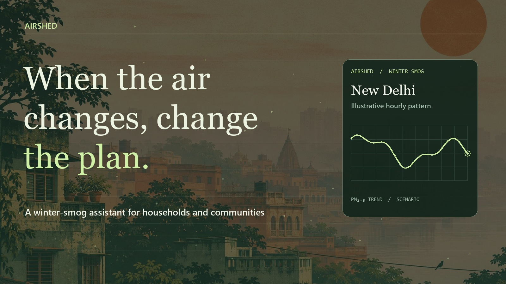
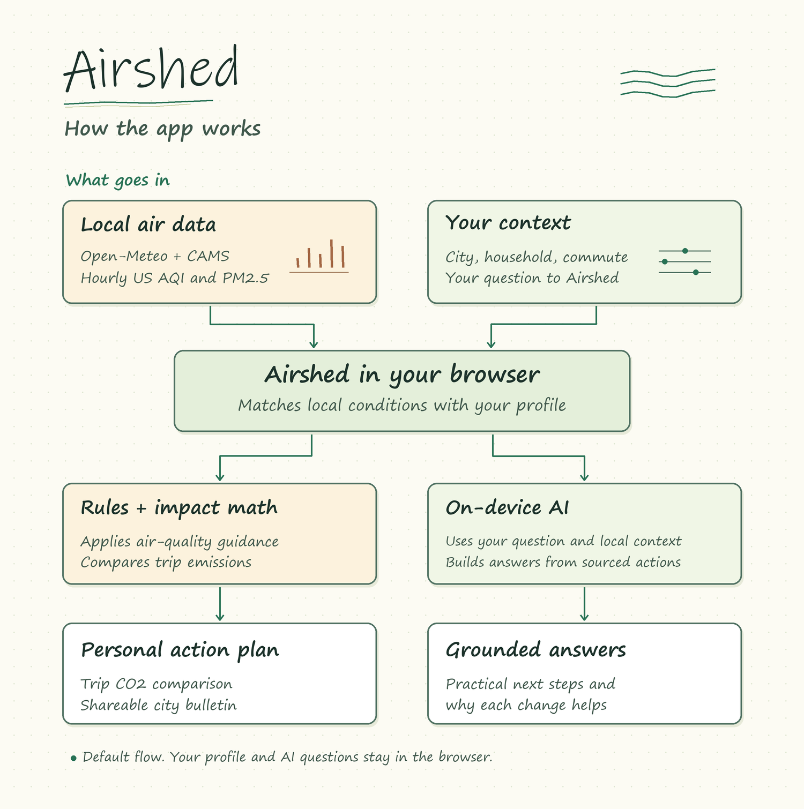

# Airshed

**Plan your day around local air quality.**

Airshed turns hourly air forecasts into practical choices for your household, commute and community. Built for **PromptWars Challenge 6 · Urban Air Quality Assistant**.

[Try Airshed](https://airshed-fieldguide.vercel.app/) · [Watch the 47-second demo](https://drive.google.com/file/d/1UopXAB1ao_PbQ05wUL44oRefne3h_Zni/view)

## The demo

Three friends are getting ready to drive from Hyderabad to Goa. They check a simulated smog day, ask Airshed about the drive, and look up Panaji before making outdoor plans.

## What you can do

- **Plan the day.** Check hourly AQI, then get indoor air and travel suggestions tailored to your household.
- **Ask a follow-up.** The bundled on-device model builds answers from sourced actions and your local forecast. [Model card](genai/MODEL.md)
- **Compare and share.** Estimate tailpipe CO₂ for a travel swap, or copy a timestamped air brief for your group.

## How it works

## Run locally

Start the app with `python -m http.server 4187` and open [localhost:4187](http://localhost:4187). Run `npm test` with Node.js 22+ to check forecast handling, planning, model responses and emissions math.

## Data and assumptions

- Airshed uses outdoor CAMS forecasts and **US AQI** bands. The winter scenario is labeled as simulated. [Open-Meteo](https://open-meteo.com/en/docs/air-quality-api) · [AirNow](https://www.airnow.gov/aqi/aqi-basics/)
- The transport comparison estimates **tailpipe CO₂** using a typical solo car and an illustrative diesel bus. Distance, vehicle and occupancy affect the result. [EPA vehicle baseline](https://www.epa.gov/greenvehicles/greenhouse-gas-emissions-typical-passenger-vehicle)
